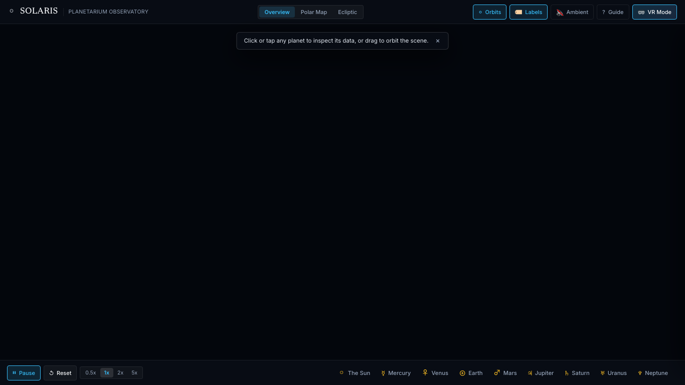

# SOLARIS — Interactive 3D Planetarium & VR Solar System



**Solaris** is an observatory-grade, interactive 3D and WebXR Virtual Reality Solar System planetarium built with **A-Frame**, **Three.js**, **HTML5**, **Vanilla CSS3**, and **JavaScript (ES6+)**. 

Designed as a refined educational space exploration exhibit, Solaris departs from generic dashboard tropes in favor of an authentic planetarium aesthetic: deep velvet cosmic space, natural planetary illumination, proportionate celestial geometry, comprehensive NASA telemetry, space exploration histories, and a clearly separated educational section on cultural astrology and archetypes.

---

## 🌌 Key Highlights & Architectural Redesign

### 1. Visual Realism & Deep Space Atmosphere
- **Photorealistic Deep Space Starfield**: Replaced harsh, noisy starfield textures with a bespoke 2048×1024 equirectangular panorama. Features realistic stellar magnitude distribution (94% faint micro-stars, 5% intermediate temperature-tinted stars, and 1% navigational beacons), gentle galactic dust, and deep obsidian negative space.
- **Luminous, Non-Blinding Sun**: A detailed granular photosphere with limb darkening and sunspot detail. Replaced flat neon shells with a subtle, warm corona falloff (`opacity: 0.10`).
- **Authentic Proportionate Saturn Rings**: Corrected previously oversized rings down to an astronomical proportion ($1.25 R_s$ to $2.23 R_s$). Features authentic optical density gradients: faint inner C ring (Crepe ring), dense bright B ring, crisp transparent Cassini Division gap, and structured A ring.
- **Natural Planetary Lighting**: Point-source sunlight radiating from `(0, 0, 0)` with physical decay, paired with soft cosmic ambient fill (`#1e293b`) that keeps night-side hemispheres visible with realistic 3D terminator shading.

---

### 2. Typographic Identity & Editorial Design System
- **Editorial Typography Stack**:
  - **Display & Headings**: Google Fonts `'Newsreader'` (optical size serif, 400–600 weight, plus italic) provides calm, academic observatory elegance reminiscent of classic planetarium compendiums.
  - **Interface & Content**: Google Fonts `'Inter'` (400–600 weight) ensures maximum legibility across varied pixel densities and screen sizes.
  - **Scientific Measurements**: Google Fonts `'JetBrains Mono'` with tabular figures (`tnum: 1`) ensures numerical comparisons align cleanly without visual jitter.
- **Human-Centered Contextual Guidance**:
  - Contextual exploration banner (`#onboarding-hint`) gently explains: *"Click or tap any planet to inspect its data, or drag to orbit the scene."*
  - Automatically fades out upon user interaction, manual dismissal, or a 7-second gentle timeout, persisting dismissal state in `localStorage`.
- **Top Observatory Bar (48px)**:
  - Brand identity: `SOLARIS · PLANETARIUM OBSERVATORY`.
  - Camera Perspective Segmented Control: `[ Overview ]`, `[ Polar Map ]`, `[ Ecliptic Plane ]`.
  - Stateful Utility Toggles: `Hide/Show orbits (O)`, `Hide/Show labels (L)`, `Ambient Sound`, `Guide (?)`, `VR Mode`.
- **Bottom Celestial Navigator & Transport Bar**:
  - Full-width status strip aligning the Sun and all 8 planets in astronomical order (`☉ The Sun`, `☿ Mercury`, `♀ Venus`, `⊕ Earth`, `♂ Mars`, `♃ Jupiter`, `♄ Saturn`, `♅ Uranus`, `♆ Neptune`) with understated active indicators.
  - Integrated playback transport: Stateful Pause/Resume with clear icons, Speed multipliers (`0.5x`, `1x`, `2x`, `5x`), and Simulation Reset.

---

### 3. Master Planetarium Dossier (Editorial Multi-Tab Layout)
When any planet or the Sun is selected, an observatory dossier opens with six dedicated tabs featuring clean hairline specification rows instead of repetitive floating boxes:
1. **Overview**: Planet name, astronomical classification, natural educational summary, key significance highlight, and essential metrics.
2. **Physical Data**: Verified NASA physical parameters rendered in clean tabular rows (`.spec-table`):
   - Equatorial diameter, planetary mass, surface gravity, mean density, orbital velocity, orbital period, day length, solar distance, verified moon count, ring system structure, 1-bar cloud deck thermal profiles, and atmospheric percentage breakdowns.
3. **Missions**: Curated historical timeline of robotic exploration missions (e.g. MESSENGER, Venera, Magellan, Apollo, Curiosity, Perseverance, Cassini, Juno, Voyager 1 & 2, BepiColombo, Europa Clipper) with agency, discovery notes, and current mission status.
4. **Earth Comparison**: Direct comparative metrics (Earth diameters across, relative gravity, year length comparison, day length comparison, and solid crust vs gas giant structure).
5. **Astrology & Lore (Clearly Separated)**:
   - **Educational Preamble**: Explicitly distinguishes empirical astronomy (physical natural science) from traditional astrology (historical cultural metaphor and archetypal psychology).
   - Details traditional symbols, zodiac rulerships, archetypal themes, and cross-cultural mythology (Greco-Roman, Babylonian, and Vedic Jyotish).
6. **Further Reading**: Direct, verified links to official NASA Solar System Exploration pages, NASA mission archives, ESA Science, and Wikipedia articles opening safely in new tabs (`target="_blank" rel="noopener noreferrer"`).

---

## 📁 Project Structure

```text
VR Solar System with A-Frame/
├── index.html          # Main HTML5 entry point & A-Frame WebXR scene
├── style.css           # Planetarium observatory design system & responsive layout
├── app.js              # Simulation engine, A-Frame components, dossier & audio
├── server.js           # Lightweight static Node.js server (zero external dependencies)
├── test_suite.js       # Automated Chrome CDP test suite
├── README.md           # Master documentation & scientific references
└── assets/
    ├── README.md       # Asset licensing and source attribution details
    └── textures/
        ├── deep_space_starfield.png / space-background.jpg
        ├── sun.jpg
        ├── mercury.jpg
        ├── venus.jpg
        ├── earth.jpg
        ├── moon.jpg
        ├── mars.jpg
        ├── jupiter.jpg
        ├── saturn.jpg
        ├── saturn-ring.png
        ├── uranus.jpg
        └── neptune.jpg
```

---

## 🚀 How to Run Locally

### Prerequisites
- Node.js (version 18 or higher; tested on Node 26)
- Any modern web browser (Google Chrome, Safari, Firefox, Edge, Brave)

### Launch
1. Open your terminal in the project directory:
   ```bash
   cd "/Users/chaitanyaram/VR Solar System with A-Frame"
   ```

2. Start the local server:
   ```bash
   node server.js
   ```

3. Open your browser and navigate to:
   ```text
   http://localhost:3000/
   ```

---

## 🎮 Exploration & Navigation Reference

### Desktop & Laptop
| Action | Key / Gesture |
| :--- | :--- |
| **Rotate Viewpoint** | Click + Drag (Left mouse button) |
| **Zoom In / Out** | Mouse Scroll Wheel |
| **Fly Camera in Space** | <kbd>W</kbd> <kbd>A</kbd> <kbd>S</kbd> <kbd>D</kbd> keys |
| **Inspect Celestial Body** | Left click on planet sphere or click bottom celestial strip |
| **Play / Pause** | <kbd>Spacebar</kbd> or bottom transport button |
| **Reset Simulation** | <kbd>R</kbd> key or bottom Reset button |
| **Toggle Orbit Paths** | <kbd>O</kbd> key or header Orbits button |
| **Toggle Planet Labels** | <kbd>L</kbd> key or header Labels button |
| **Camera View Presets** | <kbd>V</kbd> (Overview) / <kbd>T</kbd> (Polar Map) |
| **Direct Planet Select** | Keys <kbd>1</kbd> to <kbd>8</kbd> (Mercury to Neptune), <kbd>9</kbd> or <kbd>0</kbd> (Sun) |
| **Close Dossier / Return**| <kbd>Esc</kbd> key |

### Mobile & Tablet (iOS & Android)
- **Safe Area Inset Handling**: Full support for device notches, dynamic islands, and home indicators via `env(safe-area-inset-*)`.
- **Three-State Mobile Bottom Sheet (`#planet-dossier`)**:
  - **1. Collapsed State (Default on selection)**: Compact height (~200px / 25% of viewport), leaving **~75% of the screen completely clear for the 3D scene**! Displays planet classification, headline row with one-thumb Prev/Next (`‹` / `›`) navigation arrows, tagline, 4 compact quick-fact chips (Distance, Diameter, Day length, Moons), and an action bar (`Focus`, `Follow`, `▲ Full Details`).
  - **2. Expanded State (`.expanded`)**: Generous `72dvh` reading sheet with horizontally scrollable tabs, rich scientific tables, mission timelines, Earth comparison metrics, and cultural lore. Allows independent momentum scrolling (`-webkit-overflow-scrolling: touch`) and collapses via `▼ Collapse` or tactile drag gesture.
  - **3. Closed State**: Dismissed completely via `✕` button, returning unobstructed focus to the entire solar system.
- **Direct Celestial Navigation & Transport**:
  - In collapsed state, the bottom sheet is docked cleanly above `#bottom-hud`, keeping the full celestial navigation strip and simulation playback buttons (`[ ⏸ ]`, `[ ↺ ]`) immediately accessible without needing to close the sheet.
  - Headline row includes `<` and `>` arrow buttons to cycle planets in astronomical order with one thumb.
- **Mobile Overflow Menu Drawer (`#mobile-menu-drawer`)**:
  - Replaces crowded mobile top bars with an uncluttered header: Brand (`SOLARIS`), ambient audio toggle, and Menu (`☰`).
  - Drawer contains full touch-friendly controls for Camera Perspectives (Overview, Polar Map, Ecliptic), Display Toggles (Orbits, Labels), Simulation Speed (`0.5x`, `1x`, `2x`, `5x`), Shortcuts Guide, and WebXR VR launch.
- **Mobile Landscape Mode (< 500px height)**:
  - Automatically re-docks to the right as an elegant side drawer (`width: clamp(300px, 46vw, 380px)`), ensuring the left 55% of the screen remains completely unobstructed for 3D exploration.
- **Touch Gesture Isolation**: Touch gestures (`pointerdown`, `touchstart`) on the bottom sheet, menu drawer, and HUDs are strictly isolated from the underlying A-Frame scene, preventing accidental camera dragging while scrolling or tapping controls.
- **Direct 3D Raycasting**: Raycaster configured with `cursor="rayOrigin: mouse"` directly on `<a-scene>`, enabling touch tapping on any celestial body on touchscreens without relying on camera center cursors.

### WebXR Virtual Reality
- Click **VR Mode** in the desktop header or launch via the mobile menu drawer.
- Move and look naturally using 6DoF / 3DoF head tracking.
- Aim either controller's laser ray at any planet and pull the trigger to select it.
- A 3D holographic information card appears directly in your immersive virtual space.

---

## 🔬 Scientific Scaling Disclosures

In real astronomical space:
- Distance ratio from Sun to Neptune vs Mercury is approximately **77:1** (30 AU vs 0.39 AU).
- Size ratio of the Sun to Mercury is approximately **285:1**, and Jupiter to Earth is **11:1**.

To make the solar system navigable on desktop and mobile displays without endless empty voids:
- **Sun Radius**: `3.2` units (prominent central star).
- **Planetary Diameters**: Scaled with clear relative hierarchy:
  - Terrestrial worlds: Mercury (`0.38`), Venus (`0.72`), Earth (`0.76`), Mars (`0.48`).
  - Giant worlds: Jupiter (`1.95`), Saturn (`1.50`), Uranus (`1.05`), Neptune (`1.02`).
- **Orbital Distances**: Spaced from `6.5` units (Mercury) to `46.5` units (Neptune), ensuring comfortable separation and visibility from the overview camera.
- **Orbital Velocities**: Calibrated proportionally to Kepler's laws (Mercury ~4.15x, Venus ~1.62x, Earth 1.0x, Mars ~0.53x, Jupiter ~0.22x, Saturn ~0.12x, Uranus ~0.065x, Neptune ~0.045x).

---

## 📚 Astronomy vs. Astrology: Educational Position

Solaris includes an optional Astrology & Cultural Lore section in the planetarium dossier, with the following pedagogical guidelines:
1. **Astronomy is Empirical Science**: All scientific facts, physical dimensions, orbits, compositions, and mission logs in this application are derived from empirical evidence, astronomical observations, and space agency research (NASA, ESA).
2. **Astrology is Cultural Symbolism**: Traditional astrological interpretations (zodiac rulerships, archetypal metaphors, and mythological deities) are presented strictly as historical cultural artifacts and human symbolic systems. They are not physical causes, empirical predictions, or scientific facts.
3. **Clear Structural Separation**: Astrological content is contained in its own dedicated tab with a prominent educational disclaimer.

---

## 🎨 Asset Sources & Licenses

| Celestial Body | Asset File | Origin & Agency Source | License |
| :--- | :--- | :--- | :--- |
| **Deep Space Starfield**| `deep_space_starfield.png` | Procedural non-uniform stellar density generator | CC0 / Public Domain |
| **Sun** | `sun.jpg` | Solar System Scope / NASA SDO Photosphere Map | CC BY 4.0 / Public Domain |
| **Mercury** | `mercury.jpg` | NASA MESSENGER Surface Mosaic | Public Domain |
| **Venus** | `venus.jpg` | NASA Magellan / Pioneer Venus Cloud Map | Public Domain |
| **Earth** | `earth.jpg` | NASA Visible Earth Blue Marble 2048 | Public Domain |
| **Moon** | `moon.jpg` | NASA Lunar Reconnaissance Orbiter (LRO) | Public Domain |
| **Mars** | `mars.jpg` | NASA Mars Global Surveyor / Viking Mosaic | Public Domain |
| **Jupiter** | `jupiter.jpg` | NASA Cassini-Huygens / Juno Cloud Deck | Public Domain |
| **Saturn** | `saturn.jpg` | NASA Cassini-Huygens Atmospheric Map | Public Domain |
| **Saturn Rings** | `saturn-ring.png` | Procedural radial map with C, B, Cassini, and A rings | CC0 / Public Domain |
| **Uranus** | `uranus.jpg` | NASA Voyager 2 Methane Atmosphere Map | Public Domain |
| **Neptune** | `neptune.jpg` | NASA Voyager 2 Azure Atmosphere Map | Public Domain |

See [`assets/README.md`](file:///Users/chaitanyaram/VR%20Solar%20System%20with%20A-Frame/assets/README.md) for full technical details.

---

## 🧪 Comprehensive Cross-Device Verification Matrix

Automated verification was conducted using Chrome DevTools Protocol (`node test_suite.js`) across 14 responsive viewports and all core functional modules:

| Device Category | Viewport (px) | Orientation | Horizontal Overflow | Header & Controls | Dossier Layout | Result |
| :--- | :---: | :---: | :---: | :---: | :---: | :---: |
| **Small Phone (iPhone SE)** | `320 × 568` | Portrait | Zero (320px) | Compact Icon HUD | Mobile Bottom Sheet | **PASSED** |
| **Small Phone (Landscape)** | `568 × 320` | Landscape | Zero (568px) | Compact HUD | Side Drawer Docked | **PASSED** |
| **Android Standard** | `360 × 800` | Portrait | Zero (360px) | Adaptive HUD | Mobile Bottom Sheet | **PASSED** |
| **iPhone Standard** | `390 × 844` | Portrait | Zero (390px) | Adaptive HUD | Mobile Bottom Sheet | **PASSED** |
| **iPhone Standard (Landscape)** | `844 × 390` | Landscape | Zero (844px) | Full HUD | Side Drawer Docked | **PASSED** |
| **iPhone Pro Max** | `430 × 932` | Portrait | Zero (430px) | Full HUD | Mobile Bottom Sheet | **PASSED** |
| **iPhone Pro Max (Landscape)** | `932 × 430` | Landscape | Zero (932px) | Full HUD | Side Drawer Docked | **PASSED** |
| **iPad Mini / Standard** | `768 × 1024` | Portrait | Zero (768px) | Full HUD + Presets | Tablet Bottom Drawer | **PASSED** |
| **iPad Air / Pro** | `820 × 1180` | Portrait | Zero (820px) | Full HUD + Presets | Tablet Bottom Drawer | **PASSED** |
| **Tablet Landscape** | `1024 × 768` | Landscape | Zero (1024px) | Full Desktop HUD | Desktop Side Drawer | **PASSED** |
| **Small Laptop** | `1280 × 800` | Landscape | Zero (1280px) | Full Desktop HUD | Desktop Side Drawer | **PASSED** |
| **Standard Laptop** | `1366 × 768` | Landscape | Zero (1366px) | Full Desktop HUD | Desktop Side Drawer | **PASSED** |
| **MacBook / High-Res Laptop** | `1440 × 900` | Landscape | Zero (1440px) | Full Desktop HUD | Desktop Side Drawer | **PASSED** |
| **FHD Desktop & Ultrawide** | `1920 × 1080` | Landscape | Zero (1920px) | Centered Constrained | Desktop Side Drawer | **PASSED** |

### Functional & Interaction Suite
| Functional Test | Description | Verification | Result |
| :--- | :--- | :--- | :---: |
| **Scene Initialization** | A-Frame 1.6.0 scene engine boots, loader fades out automatically | Canvas sized to 100dvh | **PASSED** |
| **DOM Verification** | Sun and all 8 planets present with valid geometry, materials, and textures | All 9 celestial spheres | **PASSED** |
| **Celestial Navigator** | All 9 celestial strip buttons respond to click and touch events | Selected state synced | **PASSED** |
| **Direct 3D Raycasting** | Direct tap/click on celestial spheres via raycast cursor | Clickable component verified | **PASSED** |
| **Multi-Tab Dossier** | Overview, Science, Missions, Compare, Astrology, and Sources tabs load data correctly | Zero truncated sections | **PASSED** |
| **Dossier Scrollability** | Detailed telemetry tables and mission cards scroll smoothly | `scrollHeight > clientHeight` | **PASSED** |
| **Astrology Disclaimer** | Prominent "Astronomy vs. Astrology" educational notice verified | Educational banner active | **PASSED** |
| **Saturn Ring Proportions** | Authentic double-sided ring with Cassini Division verified | Physical ring geometry | **PASSED** |
| **Simulation Transport** | Pause, Resume, 2x speed multiplier, and Reset back to starting positions | Keplerian clock verified | **PASSED** |
| **Camera View Presets** | Overview, Polar Map, and Ecliptic Plane camera transitions | Smooth angle animation | **PASSED** |
| **Exploration Guide Modal** | Opens with complete shortcuts table and dismisses cleanly | Responsive modal dialog | **PASSED** |
| **Console Health** | Zero application errors or unhandled exceptions | 0 errors detected | **PASSED** |

---

## 🚢 Static Deployment Instructions

Solaris requires no backend server, database, or build pipeline. It can be hosted on any static web host:

### 1. GitHub Pages
1. Push this repository to GitHub.
2. In GitHub repository settings, navigate to **Pages**.
3. Under **Build and deployment**, select **Source: Deploy from a branch** -> `main` / root (`/`).
4. Your site will be live at `https://<username>.github.io/<repository-name>/`.

### 2. Vercel
```bash
npx vercel
```
Or link the repository directly in the Vercel dashboard.

### 3. Netlify
Drag and drop the project folder directly into [Netlify Drop](https://app.netlify.com/drop).

> **WebXR Secure Context Note**: WebXR requires HTTPS (or `localhost`). GitHub Pages, Vercel, and Netlify automatically provide free SSL/TLS certificates.
